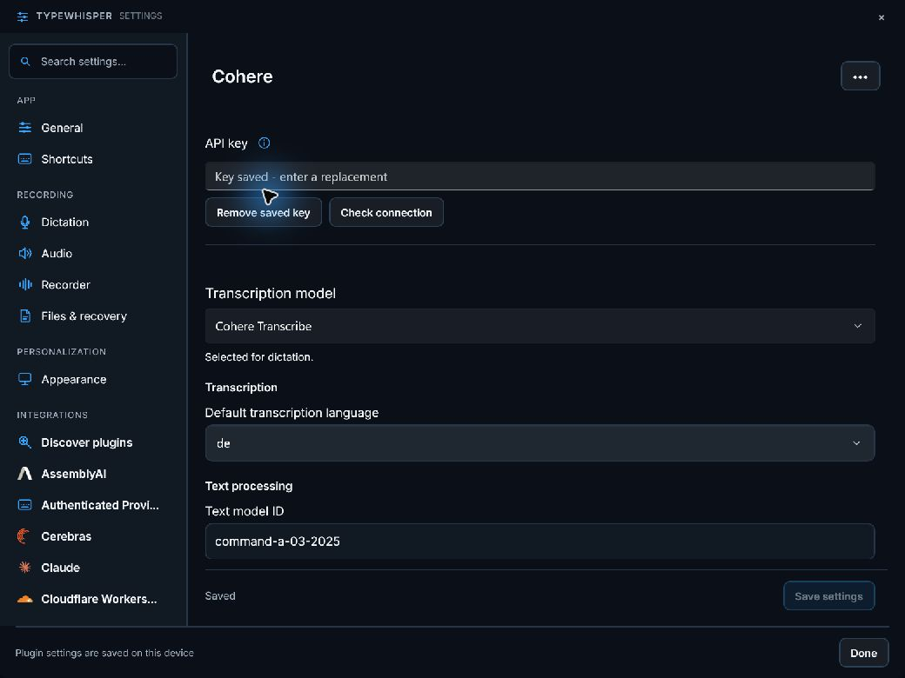
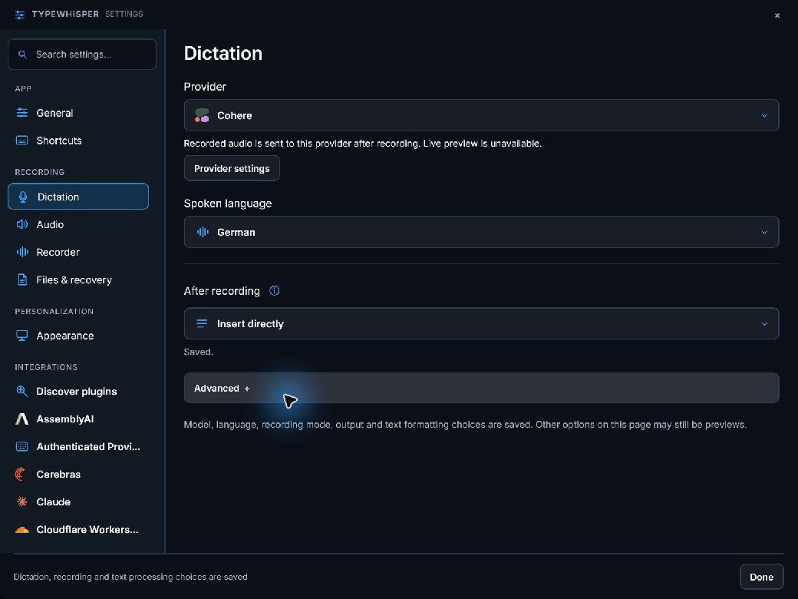

# Cohere for the portable host

Portable .NET 10 package `com.typewhisper.cohere`, version `1.1.4`, requiring host `1.1.2`.

## Behavior

Provides Command text processing and cloud Cohere Transcribe with 14 supported language choices, a default language, text model selection and temperature. Connection validation uses `/v1/models`.

The Mac `CoherePlugin` is now transcription-only. The separate local `CohereTranscribe`/macOS `CohereLocal` engine is not this cloud provider. Dictionary hints and real-time transcription are not advertised.

Setup: **API key; choose the default transcription language**. Settings are rendered by the host in English/German. API keys use the host secret store, with a staged encrypted-key reference and one configuration commit. Failed writes keep the active configuration. Removing a key retains nonsecret preferences. Redirects are disabled and provider HTTP failures retain status/retry metadata. Opening the settings page sends no network request.

Invalid restored model IDs are excluded from the model list. Invalid fallback languages, overlong model IDs and invalid custom temperatures fail with typed configuration errors before HTTP requests.

## Verification

```powershell
dotnet test plugins/TypeWhisper.Plugin.Cohere/Tests/TypeWhisper.Plugin.Cohere.Portable.Tests.csproj -c Release
dotnet msbuild plugins/TypeWhisper.Plugin.Cohere/portable.proj '-t:Build;CopyPackage' -p:Configuration=Release -p:PluginDestination=<staging-directory>
```

The provider test suite covers protocol requests/responses, HTTP errors, malformed JSON, cancellation, key persistence/failure/removal, host settings rendering and independent ZIP installation/configuration/restart/uninstall/reinstall through the immutable portable store. The resulting package contains only the provider DLL, dependency manifest and plugin manifest.

The uploaded-audio API requires an explicit language; the plugin uses its configured default when the host requests Automatic. Uploads larger than 25 MB are rejected locally. Multipart scalar fields precede the audio file, and Command A output is limited to 8,192 tokens. Realtime dictation is not advertised. Workflow UI and ARM64 execution need separate acceptance.

Reference: [provider documentation](https://docs.cohere.com/docs/audio-transcription-quickstart).




