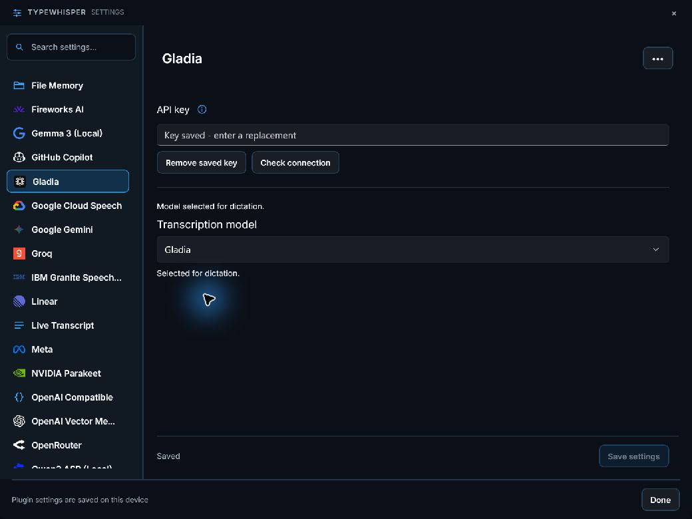
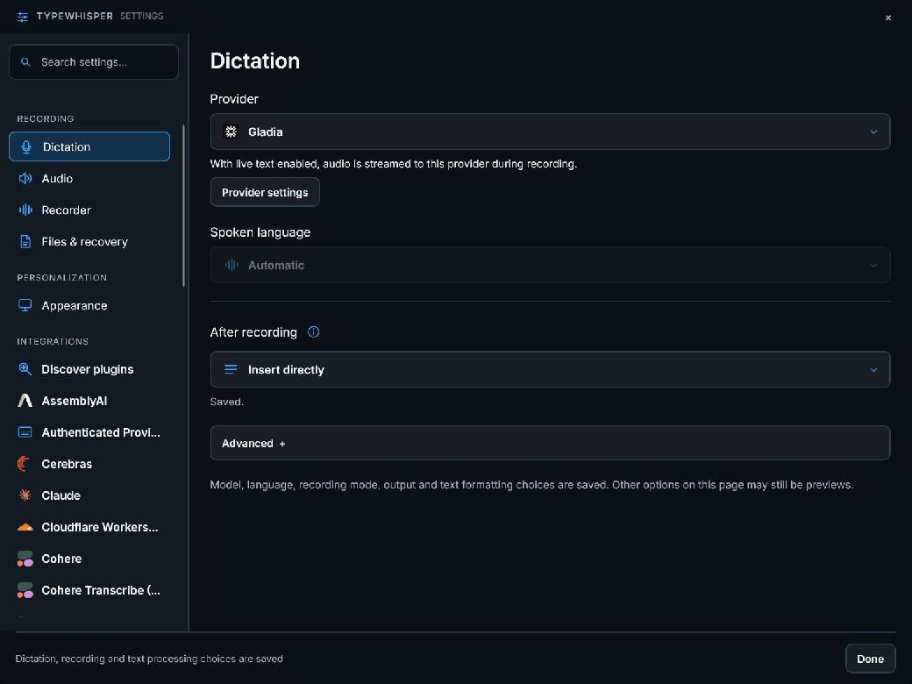
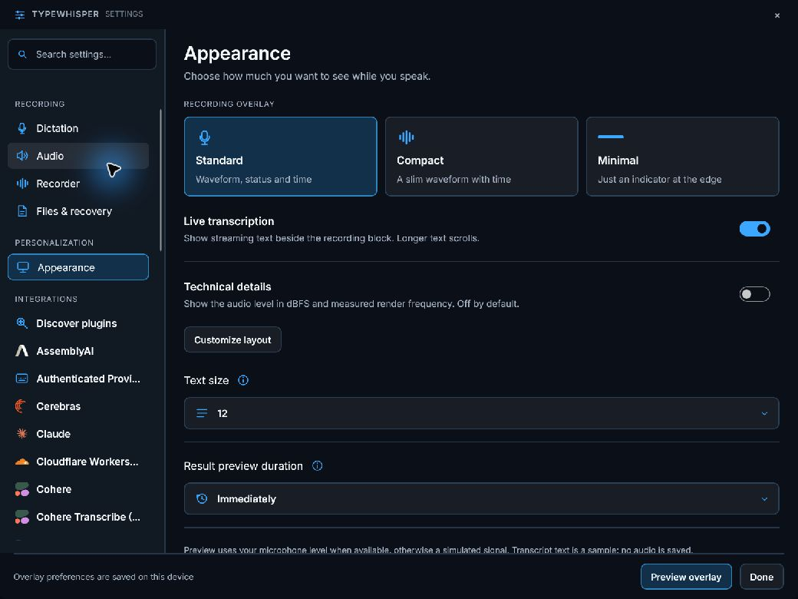
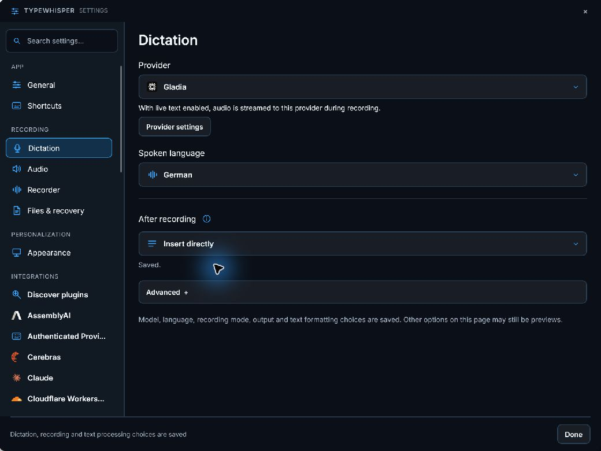

# Gladia for the portable host

Portable .NET 10 package `com.typewhisper.gladia`, version `1.2.4`, requiring host `1.1.5`.

## Behavior

Recorded-audio transcription uploads audio, submits an asynchronous job and polls its result with bounded polling and cancellation. Ordered language hints, code switching and custom vocabulary are supported.

The Windows live path uses Gladia V2 (`solaria-1`): authenticate `POST /v2/live`, validate the returned secure Gladia WebSocket URL, then send mono 16 kHz PCM16 chunks. Ordered language hints and custom vocabulary are preserved. Partial utterances replace the preview; confirmed utterances are emitted once. Stop sends `stop_recording` and waits for `end_session`. Incomplete or interrupted sessions fail so the host can use its retained recording as fallback. Uploaded recordings follow the provider retention policy; no automatic remote deletion is claimed.

Setup: **Gladia API key**. Settings are rendered by the host in English/German. API keys use the host secret store, with a staged encrypted-key reference and one configuration commit. Failed writes keep the active configuration. Removing a key retains nonsecret preferences. Redirects are disabled and provider HTTP failures retain status/retry metadata. Opening the settings page sends no network request.

The polling endpoint is constructed from the returned job UUID; duration is read from result metadata. Regression fixtures assert the complete upload/submit/poll sequence.

## Verification

```powershell
dotnet test plugins/TypeWhisper.Plugin.Gladia/Tests/TypeWhisper.Plugin.Gladia.Portable.Tests.csproj -c Release
dotnet msbuild plugins/TypeWhisper.Plugin.Gladia/portable.proj '-t:Build;CopyPackage' -p:Configuration=Release -p:PluginDestination=<staging-directory>
```

The provider test suite covers protocol requests/responses, HTTP errors, malformed JSON, cancellation, key persistence/failure/removal, host settings rendering and independent ZIP installation/configuration/restart/uninstall/reinstall through the immutable portable store. The resulting package contains only the provider DLL, dependency manifest and plugin manifest.

Streaming tests cover session initialization, PCM ordering, language/vocabulary configuration, endpoint validation, fragmented messages, replacement partials, duplicate finals, final-utterance delivery, typed errors, premature closure, cancellation and timeout. A host language selection is sent as a fixed language with code switching disabled; Automatic keeps provider detection. ARM64 execution needs separate acceptance.









References: [live quickstart](https://docs.gladia.io/chapters/live-stt/quickstart), [session configuration](https://docs.gladia.io/api-reference/v2/live/init), [WebSocket protocol](https://docs.gladia.io/api-reference/v2/live/websocket).

Dictionary terms use the structured host contract 1.1.5 or newer, preserving literal commas inside each entry. Older plugin packages keep their original prompt contract.
